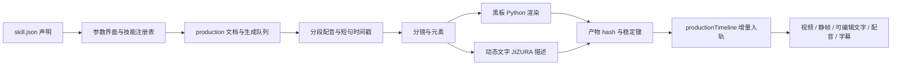

# TO DO 扩展开发与导入准则

本规范对应 2026-10-09 的实现。可安装包使用 `todo-extension-pack/1`；技能内部仍使用 `todo-skill-pack/1`。扩展安装与生成内容入轨是两个独立动作：拖入包只安装和刷新工具列表，不会启动配音、生图或改变工程时间轴。

**已经自由开发完成一套视频工作流，希望让 agent 改造成可安装、逐元素可编辑的扩展：先读 [工作流迁移指南](workflow-to-extension.md)，并使用 [agent 改造任务模板](prompts/convert-workflow-to-extension.md)。** 本文说明包格式与现有架构，迁移指南说明如何拆阶段、拆图层、映射接口、处理宿主缺口和验收。

## 1. 现有两种扩展如何连接时间轴



| 层 | 黑板手绘 | 动态文字 | 主要代码 |
|---|---|---|---|
| 声明 | `builtin.chalk-hand`，production，Python | `builtin.dynamic-text`，production，text/jizura | `server/skills/*/skill.json` |
| 发现与校验 | 扫描内置与用户目录，校验参数和运行时 | 同一注册表，前端另有内置文字包兜底 | `server/skillPacks.mjs`、`src/lib/dynamicTextPack.ts` |
| 编辑界面 | 声明生成参数表，工作台编辑分段、镜头和元素 | 同一参数表与成片工作台 | `src/components/SkillsPanel.tsx`、`ProductionStudio.tsx` |
| 公共生成层 | 文档、队列、分段配音、缓存、字幕 | 复用相同生成层 | `server/production/doc.mjs`、`layers.mjs`、`runner.mjs` |
| 内容层 | 素材生成后调用 render.py，产出入口 WebM、保持 PNG、笔尖轨迹 | 按配音时间戳拆原文，产出 `dynamicText`，不用生成画面视频 | `server/skills/chalk-hand/render.py`、`server/production/dynamicText.mjs` |
| 入轨 | 音频、书写视频、保持静帧、字幕；手势根据轨迹跟随 | 音频、原生可编辑文字、字幕 | `src/lib/productionTimeline.ts`、`chalkHand.ts` |
| 播放与导出 | 媒体与手势合成 | 宿主 JIZURA 引擎解释文字描述，预览与导出复用 | `src/lib/jizura/`、`monitorDraw.ts` |

**匹配依靠数据，不依靠名字、画面相似度或拖放顺序。**

1. `skillId` 精确选择注册表里的扩展；`pipeline` 选择宿主流程；`runtime` 决定渲染适配器。
2. 每段口播有配音时长和短句时间戳。分镜的 `start`、元素的 `at` 是短句索引，宿主换算为毫秒；动态文字也直接使用该配音时间窗口。
3. 时间轴模块用生产文档 ID 与稳定产物键匹配原片段：例如 `segment/voice`、`segment/element/draw`、`segment/element/hold`、`segment/board/text`、`segment/subs`。片段记录 `meta.source.jobId/key/rev/layout`。
4. `rev` 来自生成层输入 hash。同键同版本不重复插入；新版产物替换原产物，并尽量保留用户的变换修改。用户删掉的同版本片段不会被每次轮询重新插回。
5. 用户提交时登记整组位置：播放头或序列末尾。源时间以秒映射到时间轴，渲染协议中的 `startMs/endMs` 先除以 1000，最后按工程帧率吸附。配音移动、裁剪、变速会影响对应画面的时间映射；配音时长改变时，后续分段相应后移。
6. 只有工程权威窗口负责自动入轨，避免浮窗重复插入。开启 `autoTimeline` 后增量同步；安装扩展本身不参与此过程。

简单一次性技能另走 `src/lib/aiJobImport.ts`：完成任务返回媒体 URL，经去重与服务端确认后放入媒体库和时间轴。历史 narrated 流程由 `narratedTimeline.ts` 保留兼容。新口播成片建议使用 production。

## 2. 选择接入方式

| 需要开发的内容 | 建议声明 | 安装后能力 | 需要改宿主吗 |
|---|---|---|---|
| 动态文字风格、默认参数组合 | skill + production + text/jizura | 同步口播、可编辑文字、字幕 | 使用现有引擎和参数语义时不需要 |
| 自定义画面生成或动画渲染 | skill + elements/production + python | 生成受支持的媒体产物并入轨 | 渲染能映射现有协议、参数缓存能正确失效时不需要 |
| 图片风格与提示词模板 | style + todo-style-pack/1 | AI 图片面板中可选 | 不需要 |
| 角色精灵图动画模板 | animation + todo-anim-pack/2 | AI 动画面板中可选 | 不需要 |
| 新浏览器渲染引擎、新片段类型、新管线 | 新宿主适配器 | 需增加校验、生成、预览、导出、入轨支持 | 需要；当前不能仅凭 ZIP 热加载任意 JS |

Python 扩展在用户发起生成时运行本地代码。安装仅解包和校验，不执行脚本、安装依赖或运行安装钩子；请明确说明所需 Python/FFmpeg/库，使用已有环境。可配置 `TODO_PYTHON`。宿主运行渲染器时注入 `BLACKBOARD_ROOT` 等工具环境变量；复用黑板代码时保留对这些变量的读取，不能依赖用户安装目录具有原源码的 vendor 相对层级。

tts/subtitle 技能注册表本身也支持，但现有配音/字幕面板有固定业务入口；安装任意这类包不等于自动增加独立入口。本次通用技能列表针对 elements/narrated/production。

## 3. 可分发包格式

`.todoext` 是 ZIP 容器，也接受符合相同规范的 `.zip`。扩展包根目录必须直接有 `extension.json` 和对应 manifest；不能多套一层外部文件夹。普通素材 ZIP 不会自动解成媒体。

```text
paper-titles.todoext
├─ extension.json       # 打包工具自动生成
├─ skill.json           # skill 类型；style 用 style.json，animation 用 anim.json
├─ README.md
├─ render.py            # Python 技能才需要
└─ assets/              # 可选；manifest 引用的资产必须打入包
```

外层声明示意（不要手填省略的 SHA，使用打包命令生成）：

```json
{
  "spec": "todo-extension-pack/1",
  "kind": "skill",
  "manifest": "skill.json",
  "files": [
    { "path": "skill.json", "size": 1234, "sha256": "文件实际内容的64位小写SHA256" }
  ]
}
```

`kind` 只接受 `skill/style/animation`；对应 manifest 的 spec 分别为 `todo-skill-pack/1`、`todo-style-pack/1`、`todo-anim-pack/2`。`files` 必须包含包内全部普通文件（不包含 extension.json 自身），文件路径、字节数和 SHA-256 都需要吻合。SHA 校验用于检测内容损坏，不是作者签名。

ID 使用自己的命名空间，如 `yourname.paper-titles`；`builtin.*` 为宿主保留。版本使用三段数字，如 `1.0.0`。同 ID 高版本替换安装，同版本且内容相同跳过，同版本内容不同要求升版本，旧版本拒绝降级。用户安装路径为 `$TODO_DATA_DIR/skills|styles|anims/<id>`，开发默认是 `.data`。

限制：压缩包 ≤512 MB，展开总量 ≤1 GB，单文件 ≤256 MB，最多2000项（含外层声明与目录项）。自包含工作流可打包字体、BGM、特效与脚本。禁止绝对路径、`..`、反斜杠、Windows 保留文件名、大小写重名和未声明文件。打包器禁止符号链接；安装先验证临时目录，再替换目标目录；升级替换失败恢复旧目录。用户扩展目录不能是符号链接。

## 4. skill.json 作者准则

以 `examples/extensions/paper-titles/skill.json` 为完整可运行模板。它复用现有动态文字引擎，修改了 ID、名称、描述和文字/强调颜色默认值，保留引擎需要的参数。

| 字段 | 准则 |
|---|---|
| spec/id/name/version/author/description | spec 固定；ID 永久稳定；修改已发布内容必须升版本；名称可修改 |
| pipeline | 选择已有管线，不自行创造值；口播作品优先 production |
| input | 声明文案标题、长度上限、占位提示 |
| params | 每项声明稳定 id、类型 select/number/text、label、default、分组；select 声明 options，number 声明范围与 step |
| quick/when | quick 引用已有参数 ID；when 做条件显示，不承担运行代码职责 |
| planner/assets | 使用该管线支持的提示词和资产声明；模板变量只能引用已声明输入 |
| runtime | 文字为 `{ "type": "text", "engine": "jizura" }`；Python 使用包内相对 `.py` entry 与 timeoutSec |
| output | 声明管线支持的 mime/codec；动态文字虽然沿用标准视频输出声明，实际 production 画面返回文字描述 |

参数只声明 UI 不会凭空让渲染引擎理解新行为。已有文字引擎参数含义见 `docs/dynamic-text-extension.md` 和 `server/production/dynamicText.mjs`；新增参数必须由对应渲染器消费。未知参数、非法选项、越界数值会被宿主校验拒绝。

Python production 的渲染缓存目前只跟踪 `RENDER_PARAM_KEYS` 中的固定参数；自定义参数影响画面时必须检查/扩展宿主的指纹适配，否则 UI 改值可能继续复用旧产物。分发包也不能单靠 manifest 替换宿主 TTS/分镜/生图服务。具体缺口判断见迁移指南。

Python 渲染入口固定为：

```text
python render.py --request <宿主生成的请求JSON路径>
@progress {"phase":"render","pct":0.5}
@result   { ...符合对应渲染模式的产物... }
@error    {"message":"可读的失败原因"}
```

stdout 每条协议消息占一行，成功退出0，失败退出非0；日志使用普通行。请求协议为 `todo-skill-render/1`，宿主发布清单为 `todo-skill-output/1`。不要在扩展里直接修改 React/Zustand 或自行插入时间轴；输出可复用产物交给宿主。

不同模式的输出不相同，完整字段和可运行旧版夹具请直接参照：

- `server/skills/chalk-hand/PROTOCOL.md`：elements、scene-clips、plate 的输入输出与手势轨迹。
- `server/production/PROTOCOL.md`：生产文档、时间锚点、各层 hash、重生成与入轨。
- `scripts/fixtures/chalk-elements.skill.json`：一句话画面技能 manifest。
- `docs/dynamic-text-extension.md`：可编辑动态文字配置、预览与导出。

## 5. 开发、打包、安装

从完整示例复制目录，先修改 ID，再修改已支持参数的默认值。以工程根目录运行：

```powershell
npm run extension:pack -- ./examples/extensions/paper-titles ./examples/extensions/paper-titles.todoext
npm run extension:test
npm run skills:check
npm run build
```

打包器自动识别内部 manifest、执行现有严格校验、生成完整性清单；输出包应放在源码目录之外，避免把上次输出打进下一次包。

将 `.todoext` 拖入 TO DO 起始页或编辑界面任意位置。校验成功显示安装结果；技能列表、AI 风格/动画列表刷新。混合拖入包和普通视频/图片时，包先安装，普通文件随后导入媒体库；纯媒体拖放保留原行为。多个包按顺序处理。

技能安装后打开「拓展」，选择新包，输入文案发起生成；开启自动入轨后按上述时间锚点进入时间轴。示例的实际配音生成仍需要配置已有 AI/配音服务，安装不需要这些服务。

技能升级后保留尚未提交的文案，参数恢复新版默认值、旧规划清空，避免已删除的参数继续提交；已经生成的工程片段不会因安装而自动改动。

作者验收：包可安装且列表出现；参数默认值有效；使用真实服务生成后产物存在；播放、裁剪、移动、变速、导出正常；局部重做不会重复入轨；旧工程可继续打开；没有网络密钥、缓存、大型依赖目录或私有素材混入发行包。

## 6. 本次新增实现位置

`server/extensionPacks.mjs`：打包、ZIP/清单校验、安装与升级；`scripts/pack-extension.mjs`：作者 CLI；`POST /api/ai-extensions/import`：最多512 MB的二进制上传接口，返回 `{ ok, extension: { id, name, version, kind, action } }`，安装失败返回错误；`src/lib/extensionImport.ts`：文件识别、拖放拦截、串行导入、刷新事件；`App.tsx`：全局入口；SkillsPanel/AiPanel：列表刷新。

接口要求 `Content-Type: application/octet-stream`，仅接受无 Origin 的本地客户端、file 页面 `null` Origin，以及 loopback Origin；异地 Origin 和浏览器简单请求的内容类型拒绝，也不开放跨域预检，防止外部 sandbox 页面利用 `null` Origin 写入。它不提供后台自动下载、远程市场、签名认证或卸载界面。Python 包生成时仍是本地代码执行，来源和依赖由作者与使用者负责。
