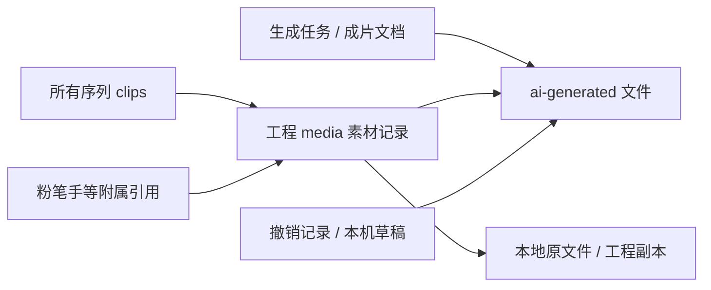

# 媒体记录与生成文件

项目的 `media` 是素材库记录。删除记录不代表删除原始文件；时间轴片段、其他序列、草稿和撤销历史仍可能引用素材。外部导入文件不属于生成文件清理范围。

## 界面操作

媒体库支持 Ctrl/Cmd 多选、Shift 范围选择、全选和来源筛选。卡片显示生成/本地来源及全部序列的引用数，悬停可查看文件位置。

“移除所选”先显示素材和引用清单，确认后同时移除媒体记录与全部序列引用，解除留下的链接、清除被删除的粉笔手依赖。一次撤销恢复素材与片段，仅恢复本次操作涉及的素材/片段，保留删除后新导入的无关素材和自动入轨的新片段。工程 `settings.removedGeneratedMedia` 记住明确移除的生成文件身份，轮询不会将其静默恢复；新哈希文件不受影响。撤销/重做同步处理该记录。

“清理历史生成”分两步：扫描引用并展示可清理文件/空间/保留原因，再确认清理磁盘文件。“管理生成记录”列出全部成片和最近 100 条任务，支持批量选择终态记录和二次确认。删除生成记录保留工程素材/片段及磁盘产物，之后重新扫描才清理孤立文件；运行和排队记录不能在此删除。最近 100 条以外的任务仍受后端引用保护，需通过任务接口或按当前界面刷新逐批处理，不能因列表截断当作孤立文件。

本次磁盘清理仅覆盖 `ai-generated`；项目文件夹内的生成副本和预览/代理缓存没有在此删除。保留撤销历史会让已从工程移除的生成文件暂时不能清理，这是为了保证撤销能够恢复素材。窗口提供“清空撤销记录并重新扫描”，需再次确认才丢弃整个工程的撤销/重做记录；其他引用仍需检查。重新打开工程后，内存中的撤销历史也不再参与保留。

AI 输出文件存放在 `AI_OUT`（`TODO_DATA_DIR/ai-generated`，默认 `.data/ai-generated`），由 `/ai-generated/<name>` 提供。生产文档存在 `productions/*.json`，AI 任务存在 `ai-assets.sqlite` 的 `ai_jobs`。删除生产文档或任务记录不会自动删除输出文件。记录仍存在时，文件清理保护其全部已知引用，包括已入库任务的输出、请求参数、参考图、生产文档中的候选图和配音，以及配音的配套 timing / JSON 文件。

## 清理接口

- `POST /api/ai-media-cleanup/preview`：`{ files?: string[], retainedFiles: string[] }`。省略 `files` 扫描生成目录的历史孤立文件。返回 `{ ok: true, token, candidates: [{ name, bytes }], blocked: [{ name, reason }], totalBytes }`。
- `POST /api/ai-media-cleanup/execute`：`{ token: string, retainedFiles: string[] }`。返回 `{ ok: true, deleted: string[], blocked: [{ name, reason }], failed: [{ name, error }], freedBytes }`。

客户端在两次调用时都需提供当前项目、所有序列、本机已知草稿和撤销历史仍引用的生成文件。执行时同时保留预览时和执行时的引用。任务记录/生产文档仍引用的文件会显示阻止原因；用户可通过现有界面先处理这些记录，再重新预览。服务不会自动删除任务或生产文档。

两次调用须使用 `Content-Type: application/json`。服务拒绝外部网站的 Origin，允许本地应用或本地浏览器，以防其他网站用表单式请求触发本机文件清理。

记录管理中的删除请求使用 `DELETE /api/ai-jobs/<id>?terminalOnly=1` 或 `DELETE /api/ai-productions/<id>?terminalOnly=1`。服务根据执行时的状态核对：任务只允许 `done/error/imported`，成片存在运行或排队任务时返回 409，保留文档和队列。这样另一窗口重新生成后，旧列表上的确认不会意外取消任务。不带参数的原有取消/删除接口行为保持原样。

预览令牌只在服务内存中保存，五分钟过期，最多 32 份，使用一次后失效。文件列表最多 10000 项，请求最多 2 MB。执行前重新读取所有生产文档和所有 AI 任务（不受界面列表数量限制），检查文件大小、时间、inode 和 SHA-256。文件变化或新增引用会阻止删除。生成任务和锁定生产文档的同名前缀输出也受到保护。

清理只允许生成目录下的安全单层文件名。路径穿越、链接、真实路径越界、目录和特殊文件均不会删除；没有递归删除。生成目录本身或其父路径发生链接重定向也会拒绝操作。不可读取或损坏的生产文档、任务数据库、已引用 JSON 配套记录会使引用核对失败，整次清理停止。

## 已知边界

服务无法发现用户保存在其他目录、其他设备或未加载的独立项目文件中的引用。这些项目可能仍使用旧 `/ai-generated/` 文件；清理历史孤立文件前应确认已备份，或打开相关项目将其引用加入保留列表。清理不能保证这些未知项目仍能访问被删除的文件。服务不会扫描、删除或修改原始外部素材。

文件操作与引用检查在一次同步处理内完成，避免本服务事件循环中途插入生成/编辑操作；其他进程同时更改目录仍存在操作系统层面的竞争窗口。UI 应显示预览数量、空间、保护原因、未知项目提示，并仅对用户确认过的预览执行删除。

## 验证

先运行 `npm run build` 更新测试用样式，然后运行 `npm run media:test`。后端测试使用临时目录与临时 SQLite，覆盖真实文件删除、引用/配套文件保护、修改后重验、令牌失效、HTTP 来源与格式检查，以及终态记录被重新排队时拒绝删除。浏览器测试在隔离 Electron profile 中验证多选/范围选择、跨序列清除、一次撤销/重做、保留后续导入与自动入轨、粉笔手抑制、StrictMode 扫描、记录批量管理和撤销清空的再次确认。不会在用户工程或真实生成目录执行清理。

运行 `npm run segment:test` 可验证分段截止、真实请求取消、回退保持原文与停止后不启动配音。分段分析另见 ai-segmentation-latency.md。
