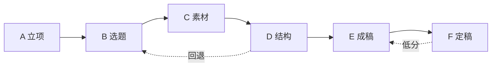

# 交互式口播备忘录 PRD v1.1（优化版）

> **一句话**：把现有「口播备忘录」从「纯文本 + 选区 AI」升级为**分阶段决策工作台**——用户只负责拍板，系统负责发散、起草、局部修改。  
> **产品落点**：`todo-editor` 内 `ScriptMemo` 的演进，不是另起独立 App。  
> **相对 v1.0**：砍摩擦、并阶段、前移事实约束、对齐现有成稿逻辑线与下游 TTS/发布。

---

## 0. 优化摘要（相对 v1.0）

| 问题 | v1.0 | v1.1 |
| --- | --- | --- |
| 阶段过多易弃用 | 11 个用户阶段 | **6 个用户阶段**（内部仍可拆子步骤） |
| 与现有能力脱节 | 独立产品感 | 明确升级 `ScriptMemo`；终稿直连 TTS / 发布台 |
| 与成稿方法论冲突 | 钩子+大纲偏通用模板 | 大纲强制对齐「主张 → 下一问 → 钉子」逻辑线 |
| 事实核查太晚 | 扩写后才查 | **素材门禁前置**；扩写禁止无来源数据；终前再扫一遍 |
| 口语化 / 风格 / 节奏互相打架 | 5→6→7 串行易覆写 | 合并为「整稿打磨」一次完成，强度可调 |
| MVP 过大 | 含风格库、版本树全量、联网搜索 | MVP 只做决策卡片 + 状态机 + 局部改写 + 事实门禁 |
| 开放问题未拍板 | 附录 B 全空 | 给出默认拍板（可改） |

---

## 1. 背景与问题

现有口播备忘录能力：

- 全文编辑 + 字数/时长估算（约 4.5 字/秒）
- 选区旁 AI：改写 / 插入 / 解释 / 提问
- 随工程保存，与剪辑台 `~` 切换

痛点不变：一次性整篇质量平庸、数据易编造、书面腔、改一处牵全身、用户只能「再生成」。

**解决思路不变，执行方式收紧**：阶段产物可检查、可选择、可回退；后阶段在前产物上 **diff 修改**；但用户看到的主路径必须 ≤ 6 步，且默认提供「快速模式」。

---

## 2. 目标用户与场景

不变。补充本产品内的真实场景：

1. 在剪辑工程里打开备忘录，从零写到可配音
2. 已有外部口播稿粘贴进来，只跑「打磨 + 事实核查 + 导出包装」
3. 终稿一键进入现有 TTS 时间轴 / 发布台文案

---

## 3. 目标与非目标

### 3.1 产品目标

1. 人工操作以「选择 + 短句指令」为主（目标 ≥ 70%）
2. 每阶段：3～5 个结构化选项 + 自定义输入
3. **无来源数据不得进入正文**（程序校验，不只靠模型自觉）
4. 可回退到任意已确认阶段节点（MVP：线性历史即可；完整版本树放 v1.0）
5. 终稿朗读时长相对目标偏差 ≤ 10%（语速默认 270 字/分 = 4.5 字/秒，与现备忘录一致）

### 3.2 非目标

| 版本 | 不做 |
| --- | --- |
| MVP | 完整版本树 UI、风格库跨项目、联网搜索深度编排、TTS 试听、自动发布 |
| v1.x | 多人审批、数字人、多语言口播（除非用户后续明确要） |
| 永久非目标（本稿） | 替代剪辑时间轴；在备忘录内做视频合成 |

---

## 4. 核心设计原则

1. **一步一事（对用户）**：主路径 6 阶段；内部子步骤可自动连跑
2. **选项优先，自定义兜底**
3. **增量修改**：整段/整篇禁止无提示重写；默认 diff
4. **状态外置**：`ProjectState` 持久化进工程文件（与 `script` 字段共存/演进）
5. **约束写在前**：禁区、locked、verified 素材优先于「写得好看」
6. **人工确认点最少化**：仅 **选题、逻辑线/大纲、终稿** 强制确认；其余默认可「AI 代决」
7. **下游优先**：终稿必须能无缝喂给现有 TTS / 字幕 / 发布链路

---

## 5. 总体流程（用户可见 6 阶段）



| 阶段 | 名称 | 内部子步骤（可对用户折叠） | 强制确认 |
| --- | --- | --- | --- |
| **A** | 立项 | 项目卡预填 | 是（可一键用推荐） |
| **B** | 选题 | 发散打分 → 可选「基于此展开」 | **是** |
| **C** | 素材 | 问题清单 → 整理入库（搜索/粘贴/上传） | 否（缺 must 素材时拦截进 D） |
| **D** | 结构 | 钩子 → **逻辑线（主张/下一问/钉子）** → 段落大纲 | **是** |
| **E** | 成稿 | 逐段扩写（含衔接）→ 整稿打磨（口语+风格+时长）→ 事实复核 | 逐段确认；打磨可代决 |
| **F** | 定稿 | 评审修订（可选）→ 朗读反馈 → 导出包装 | **是** |

### 5.1 与 v1.0 阶段映射

| v1.0 | v1.1 |
| --- | --- |
| 0 项目卡 | A |
| 1 选题 | B |
| 2 素材调研 | C |
| 3 钩子+大纲 | D（大纲改为逻辑线驱动） |
| 4 分段扩写 | E.1 |
| 5 口语化 + 6 风格 + 7 节奏 | E.2 整稿打磨（一次 diff） |
| 8 事实核查 | C 门禁 + E.3 终前复核 |
| 9 评审修订 | F.1（默认跳过，快速模式关闭） |
| 10 终稿导出 | F.2 |

### 5.2 两种模式

| 模式 | 行为 |
| --- | --- |
| **标准** | A→F 全走；C/E.2/E.3 可代决 |
| **快速**（MVP 必做） | 强制确认 B、D、F；C 用用户粘贴素材即可；E 自动扩写+打磨，只在事实失败时打断 |
| **粘贴打磨** | 跳过 A～D；从现有 `script` 进入 E.2→E.3→F |

---

## 6. 交互规范

### 6.1 决策卡片（保留 v1.0）

统一卡片协议不变：`card_type` + `options` + `recommended_id` + `allow_custom`。

布局收敛为现有备忘录三栏演进，避免另造 IDE：

```
┌──────────┬────────────────────────────┬──────────────┐
│ 阶段导航 │ 决策卡片 / 稿件正文         │ 状态面板     │
│ + 历史点 │ （与现 textarea 共存）       │ 项目卡/素材  │
│          │ 选区 AI 栏保留（P-LOCAL）   │ 字数·风险    │
└──────────┴────────────────────────────┴──────────────┘
```

- **未进入向导时**：保持今天的纯编辑 + 选区 AI（不破坏现有习惯）
- **进入「交互生成」**：顶部阶段条；中间切卡片；右侧状态；正文区仍可点选局部改

### 6.2 卡片类型

保留：`single_select` / `multi_select` / `rank` / `variants` / `diff_review` / `form` / `free_input`。

### 6.3 通用操作

保留：再来一批、基于此展开、锁定、自定义（P-INTENT）、回退、跳过/代决。

**MVP 简化**：

- 回退 = 线性撤销到上一确认点（不必画完整版本树）
- 「基于此展开」仅 B/D 提供
- 锁定支持段落与句子；素材 `used` 锁定在 E.1

### 6.4 选区快捷操作（已有能力升级）

现有：改写 / 插入 / 解释 / 提问。  
升级映射到 P-LOCAL：`改短 / 更口语 / 加例子 / 换数据 / 删除 / 自定义`；「换数据/加例子」只能打 `verified=true` 素材。

---

## 7. 功能需求

优先级：P0 MVP / P1 v1.0 / P2 以后。

### 7.A 立项（P0）

- 输入：一句话需求或空（从工程名推断）
- 产出：`project_card`（platform / duration_sec / target_chars / audience / persona / goal / taboo）
- `target_chars = round(duration_sec / 60 * 270)`
- 验收：6 字段齐全；可一键采用全部 recommended

**默认拍板（可改）**：首发平台集合 = 抖音 / 视频号 / 小红书 / B站；默认抖音。

### 7.B 选题（P0）

- 发散 15～20 → 五维打分 → 展示 Top5（角度类型 ≥ 3 种）
- 可：单选 / 基于此展开 / 自定义
- 验收：每题含角度、核心观点、评分、风险

### 7.C 素材（P0）

- 先出问题清单（must / nice），用户增删
- 入库途径（MVP）：**用户粘贴链接/摘录、上传文本**；联网搜索为 P1
- 字段：`type / content / source / date / credibility / verified / used_in`
- **硬门禁**：
  - `verified!=true` 的数据不得写入 E.1 正文
  - 进入 D 前：must 问题若无对应素材 → 提示补齐或降级为「无数据讲法」
- 验收（可配置）：数据 ≥ 3、案例 ≥ 1、类比 ≥ 1；快速模式可降为「至少 1 条 verified 或用户声明纯观点稿」

### 7.D 结构（P0）— 相对 v1.0 最大改动

顺序固定：

1. **钩子** 5 选 1（类型互斥）
2. **逻辑线**（对齐现有成稿 skill）：
   - `claim` 主张（一句话）
   - `next_questions` 观众下一问（2～4 个）
   - `nails` 钉子（每问对应的证据/例子/数字锚点，绑定 `material_ids`）
3. **段落大纲**：由逻辑线展开为 4～6 段；每段 1 个信息点、目标字数、素材绑定、情绪

结构模板仍可给 2～3 套，但必须能映射回「主张/下一问/钉子」，禁止只给空洞总分总。

验收：总字数目标 ±10%；每段 1 信息点；每颗钉子能指到素材或明确标「待补」。

### 7.E 成稿（P0）

#### E.1 分段扩写（P0）

- 逐段 2～3 个策略版本（非同义改写）
- 内部：骨架 → 填充 → 自检徽章
- 数据句末内部标注 `[m_id]`（导出剥离）
- 确认后跑衔接检查；score&lt;4 给最小改动

#### E.2 整稿打磨（P0，合并原 5/6/7）

一次产出 `diff_review`，分组标签：`oral` / `style` / `pace`。

| 强度 | 行为 |
| --- | --- |
| 轻 | 拆长句、去书面连接词、超时句删减建议 |
| 中 | + 数字口语化、术语即时解释、节奏弱窗补设问 |
| 重 | + 风格特征（若有样本）、对话感（≤5 处） |

规则优先级：**事实与 locked > 时长 > 口语 > 风格**。  
超时方案仍给 3 选 1（删段 / 删句 / 合并），作为同一卡片内的 `pace_options`。

风格样本提取（原 P-6A）为 **P1**；MVP 可用项目卡 `persona` 代替完整风格卡。

#### E.3 事实复核（P0）

- 抽取断言 vs `material_bank`
- `missing` / `mismatch` 必须处理才能进 F
- 绝对化表述降级建议（可代决为「改为限定表述」）

### 7.F 定稿（P0/P1）

- **F.1 评审**（P1）：6 维打分；每轮最多改 2 维、最多 3 轮；快速模式默认跳过
- **F.2 朗读反馈 + 导出**（P0）：
  - 粘贴卡壳位置 → 局部 3 方案
  - 导出：正文、标题×3、封面文案、简介+标签
  - 格式：Markdown / 纯文本提词器；Word 为 P1
  - **工程内动作**：写回 `script`；可选跳转 TTS 时间轴 / 发布台（调用现有入口，不在备忘录内重做）

### 7.G 横切

| 功能 | 优先级 |
| --- | --- |
| 线性阶段历史 + 回退 | P0 |
| 锁定（句/段/素材） | P0 |
| P-INTENT 意图解析 | P0 |
| 完整版本树 UI | P1 |
| 风格库 / 爆款开头库跨项目 | P1 |
| 联网搜索编排 | P1 |
| 团队模板 / 发布复盘 | P2 |

---

## 8. 数据模型

在工程文件中扩展（示意）：

```json
{
  "script": "终稿或当前正文（兼容现字段）",
  "script_workspace": {
    "schema_version": 1,
    "mode": "standard|fast|polish_only",
    "stage": "A|B|C|D|E|F",
    "substep": "E.1|E.2|E.3|...",
    "project_card": {},
    "topic": {},
    "material_bank": [],
    "logic_line": {
      "claim": "",
      "next_questions": [],
      "nails": [{ "question_id": "", "material_ids": [], "note": "" }]
    },
    "hook": {},
    "outline": [],
    "draft": [],
    "style_card": null,
    "review": null,
    "fact_check": [],
    "history": [{ "id": "", "parent_id": null, "stage": "D", "action": "confirm", "ts": "" }],
    "prompt_versions": {}
  }
}
```

兼容策略：无 `script_workspace` 时，备忘录行为与今天一致；有则显示阶段条。

---

## 9. 提示词体系

### 9.1 约定（保留）

- `{{变量}}` 注入；阶段只注入附录 A 字段
- 严格 JSON；不合 schema 自动重试 ≤2
- 程序校验优先：字数、黑名单词、`material_id` 存在性、`verified`

### 9.2 提示词清单（相对 v1.0）

| ID | 状态 |
| --- | --- |
| P-SYS | 保留，补充「遵守 logic_line，不新增钉子外论点」 |
| P-0 | → **P-A** |
| P-1A/B | → **P-B** / **P-B2** |
| P-2A/B | → **P-C1** / **P-C2** |
| P-3A | → **P-D1** 钩子 |
| **P-D2** | **新增**：逻辑线生成（主张/下一问/钉子） |
| P-3B | → **P-D3** 大纲（必须消费 logic_line） |
| P-4 / P-4C | → **P-E1** / **P-E1C** |
| P-5+P-6B+P-7 | → **P-E2** 整稿打磨（分组 diff） |
| P-6A | P1 |
| P-8 | → **P-E3** |
| P-9A/B | P1 → **P-F1** |
| P-10A/B | → **P-F2** / **P-F3** |
| P-INTENT / P-LOCAL | 保留为横切 |

> 完整提示词正文以 v1.0 为底稿；合并稿 P-E2、新增 P-D2 在实现前单独开「提示词附录」文件，避免本 PRD 再次膨胀到难维护。

### 9.3 P-D2 逻辑线（新增要点）

```
任务：为已确认选题与钩子生成「极简论点逻辑线」。
输出：
- claim：一句主张（观众听完能复述）
- next_questions：2～4 个「观众下一问」，按出现顺序
- nails：每个问题对应 1 个钉子（证据类型 + material_ids 或 gap）
硬规则：钉子不得引入素材库外的数据；claim 不得违反 taboo。
card_type=form，供用户改 claim / 增删问题后确认。
```

### 9.4 P-E2 整稿打磨（合并要点）

- 只改表达与节奏，不改事实/结构/locked
- 输出 `changes[]`，每条带 `group: oral|style|pace`
- 附 `pace_summary`（字数、预估秒、偏差%、weak_windows）
- 偏差 &gt;10% 时必须带 `pace_options`（3 案）
- 无 style_card 时用 persona 约束语气，不做强风格模仿

---

## 10. 技术架构（落在 todo-editor）

```
ScriptMemo UI
  ├─ 编辑器（现有）
  ├─ StageRail + DecisionCard
  └─ StatePanel
        │
Server: Stage Orchestrator（新）
  ├─ ProjectState 读写（工程文件）
  ├─ Prompt 模板 + 版本号
  ├─ P-INTENT
  ├─ JSON Schema 校验 + 重试
  ├─ 程序校验器（字数/素材/黑名单）
  └─ 复用现有 /api/ai-script 网关模式
        │
既有下游：TTS 时间轴 · 字幕硬烧 · 发布台
```

关键实现点：

1. **状态机明确**：非法跳转拒绝；快速模式白名单跳过
2. **JSON 校验与重试**
3. **创作 / 评审隔离**（评审不带创作对话）
4. **上下文裁剪**按附录 A
5. MVP **不**上独立搜索微服务；粘贴即可过 C

---

## 11. 非功能需求

| 项 | 要求 |
| --- | --- |
| 响应 | 选项卡 ≤10s；分段扩写 ≤15s；能流式先出 options |
| JSON 合规 | ≥98%（含重试） |
| 可追溯 | 任一句可追溯素材 id + 生成 substep |
| 兼容 | 无 workspace 的老工程仍可纯文本编辑 |
| 安全 | 素材/风格样本仅本工程；可清空 workspace |

---

## 12. 里程碑

| 版本 | 范围 | 预估 |
| --- | --- | --- |
| **MVP** | A～E + F.2；决策卡片；线性回退；P-INTENT；快速模式；Markdown 写回 `script` | 3～4 周 |
| **v1.0** | F.1 评审；P-E2 风格样本；完整版本树；提词器；跳转 TTS/发布 | +2～3 周 |
| **v1.5** | 联网搜索；跨项目素材/开头库 | — |
| **v2.0** | 发布复盘；TTS 试听标记回写 | — |

### MVP 切片建议（实现序）

1. `script_workspace` 持久化 + 阶段条空壳  
2. A/B 卡片闭环  
3. C 粘贴入库 + verified 门禁  
4. D：钩子 + 逻辑线 + 大纲  
5. E.1 分段 variants  
6. E.2/E.3 diff + 事实拦截  
7. F.2 导出包装 + 写回 `script`  
8. 快速模式 + 粘贴打磨入口  

---

## 13. 成功指标

| 指标 | 目标 |
| --- | --- |
| 立项→可配音终稿中位耗时 | ≤ 20 分钟（快速模式 ≤ 12 分钟） |
| 选择类交互占比 | ≥ 70% |
| 定稿时 fact_check 未通过项 | 0 |
| 备忘录→TTS 无手工再贴稿比例 | ≥ 90%（写回 script 即用） |
| 用户满意度 | ≥ 4.2 / 5 |
| 平均回退次数 | ≤ 2 / 项目 |

---

## 14. 风险与对策

| 风险 | 对策 |
| --- | --- |
| 仍嫌步骤多 | 快速模式默认推荐；粘贴打磨旁路 |
| 选项同质 | 提示词强制策略差 + 后端相似度重生成 |
| 无搜索时素材空 | C 强调粘贴；允许「纯观点稿」声明并禁用数据句 |
| 打磨伤事实 | E.2 后强制 E.3；数字一致性程序比对 |
| 逻辑线与大纲两套真相 | 大纲只许从 logic_line 展开；改大纲若动钉子需回写 logic_line |
| 与选区 AI 双入口混乱 | 向导阶段：选区 AI 仅 P-LOCAL；未开向导：保持旧行为 |

---

## 附录 A：阶段 × 注入字段

| 阶段 | 必注入 | 禁止注入 |
| --- | --- | --- |
| A | user_brief, projectName | 稿件 |
| B | project_card, seed | 素材、稿件 |
| C | project_card, topic | 稿件 |
| D | project_card, topic, material_bank | 全文 draft |
| E.1 | outline, previous_text, segment, segment_materials, logic_line | 其他段素材、评审 |
| E.2 | full_draft, intensity, persona/style_card, duration 参数 | material_bank（防新增事实） |
| E.3 | full_draft, material_bank | style |
| F.1 | full_draft, project_card | 创作历史 |
| F.2 | final_draft, platform, core_claim | — |

---

## 附录 B：产品拍板（v1.1 默认）

| # | 问题 | 默认结论 |
| --- | --- | --- |
| 1 | 首发平台 | 抖音 / 视频号 / 小红书 / B站；默认抖音 |
| 2 | 多语言 | v1 不做 |
| 3 | 联网搜索 | MVP 不做编排；P1 再定数据源与合规 |
| 4 | 风格样本版权 | 仅私有工程使用；上传时勾选「有权用于改写学习」 |
| 5 | 快速模式进 MVP | **是** |
| 6 | 产品形态 | **升级 ScriptMemo**，不另做独立站 |
| 7 | 大纲方法论 | **逻辑线（主张/下一问/钉子）优先于通用结构模板** |

若需改拍板，只改本表并同步里程碑，不必重写全文。

---

## 附录 C：验收清单（MVP）

- [ ] 老工程无 workspace 时行为与现网一致  
- [ ] A→F 标准路径可跑通并写回 `script`  
- [ ] 快速模式可在无搜索下完成（靠粘贴素材）  
- [ ] 粘贴打磨路径可跳过 A～D  
- [ ] 未 verified 数据无法出现在 E.1 确认稿  
- [ ] E.3 未清零不可进 F 确认  
- [ ] 选区 AI 在向导内走 P-LOCAL 约束  
- [ ] 字数/时长与备忘录顶栏算法一致（4.5 字/秒）  
